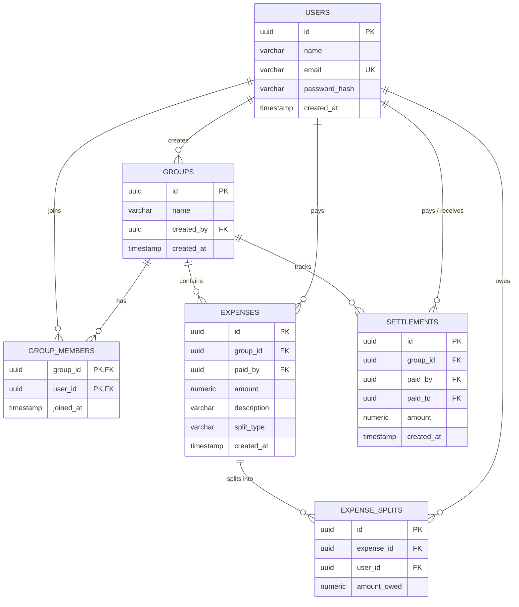

# SettleGraph 💸 – Day 2 Design & Architecture Specification

Welcome to Day 2 of the **ALTA Builder 30** challenge (Track A). Today's focus was entirely on designing the relational database schema, structuring core data models, and mapping out the user interface wireframes before writing any application code.

## 🗄️ Database Design & Schema Architecture

To prevent floating-point rounding bugs and ensure strict data integrity, all monetary values across our tables utilize PostgreSQL's exact `NUMERIC(10, 2)` data type. 

### 1. Entity-Relationship Diagram

### 2. Table Summary & Constraints
* **`users`**: Stores unique account profiles with hashed passwords (`bcrypt`).
* **`groups`**: Represents shared spaces (trips, apartments, project teams).
* **`group_members`**: Junction table with a composite primary key `(group_id, user_id)` to prevent duplicate memberships.
* **`expenses`**: Master bills tracking total amounts and split types (`EQUAL`, `EXACT`, `PERCENTAGE`).
* **`expense_splits`**: Individual rows tracking exact member debt shares per bill (`NUMERIC(10, 2)`).
* **`settlements`**: Direct repayments logged between members to clear balances without altering expense history.

---

## 🎨 UI Wireframes & Screen Architecture

The application is structured around four primary responsive screens designed in React:

1. **Authentication Screen (`/login` & `/signup`):** Secure onboarding with JWT token issuance and password hashing.
2. **Groups Dashboard (`/`):** Summary cards showing total owed, total owing, and combined net position alongside active expense groups.
3. **Group Detail & Heap Engine (`/groups/:id`):** Per-person net balance sheets, chronological feeds, and the toggle between raw pairwise IOUs and optimized Max-Heap debt simplification.
4. **Add Expense Modal:** Interactive form supporting Equal, Exact, and Percentage splits with real-time mathematical validation.

---

*Day 2 Deliverable completed and logged for ALTA Builder 30 (SettleGraph).*